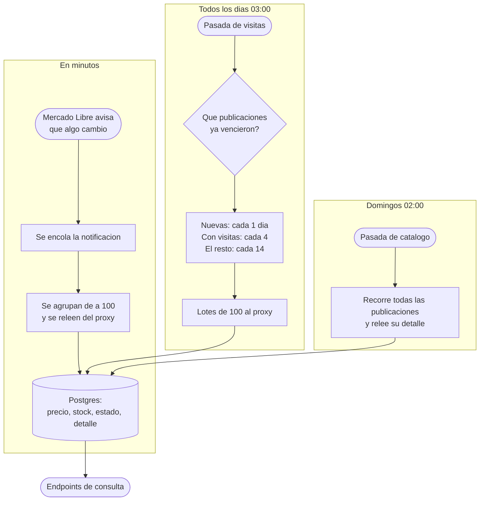

# Catalog Sync API

Microservicio interno de **Tienda Lo Quiero Acá** que mantiene en Postgres una copia del catálogo de Mercado Libre, y la deja consultable.

Mercado Libre avisa cada vez que una publicación cambia; el servicio relee esa publicación y actualiza precio, stock, estado y detalle. Aparte, mide las visitas de cada publicación y guarda el historial. Encima de eso expone endpoints de consulta que el panel y otros servicios usan para no pegarle a Mercado Libre.

## Qué hace

| | |
|---|---|
| **Sincroniza publicaciones** | Escucha el webhook de Mercado Libre y actualiza precio, stock, estado, título y detalle en minutos. |
| **Mide visitas** | Pasada diaria que guarda cuántas visitas tiene cada publicación, con historial desde mayo de 2026. |
| **Trae ventas** | Guarda las órdenes de cada publicación para cruzarlas con visitas y stock. |
| **Carga masiva** | Recorre el catálogo entero de Mercado Libre para la carga inicial o para recuperarse de un hueco. |
| **Consultas** | Expone el catálogo por MLA, por SKU, por categoría y por marca, sin consumir cuota de Mercado Libre. |
| **Otros marketplaces** | Guarda también el catálogo que otros procesos publican en Frávega, con sus corridas de import. |

## Cómo funciona



El detalle de cada paso está en la [guía funcional](docs/funcional.md). Las visitas tienen su propia página porque son la parte con más sutilezas: [Visitas](docs/visitas.md).

## Ambientes

| Ambiente | URL base |
|---|---|
| Producción | `http://104.131.117.64:3001` |
| Local | `http://localhost:3001` |

Además de los endpoints, el servicio publica tres herramientas:

| Herramienta | Ruta | Para qué |
|---|---|---|
| Documentación | `/docs` | Esta documentación, navegable y con buscador. |
| Swagger | `/api/docs` | Probar los endpoints desde el navegador. |
| Bull Board | `/admin/queues` | Ver el avance de las colas y los jobs fallidos. |

> Swagger estaba en `/docs` hasta que esa ruta pasó a ser el sitio de documentación. Si lo tenías guardado, ahora es `/api/docs`.

## Autenticación

Los endpoints protegidos usan este header:

| Header | Valor |
|---|---|
| `x-internal-api-key` | La clave interna del servicio (`INTERNAL_API_KEY`). |

Sin el header, o con una clave que no coincide, la respuesta es `401 Invalid api key`. Si el servicio arrancó sin `INTERNAL_API_KEY` configurada, la respuesta es `401 INTERNAL_API_KEY is not configured`.

No todos los endpoints están protegidos: la protección se aplica ruta por ruta para no romper consumidores que ya existían. La [referencia de la API](docs/api.md) indica cuáles la piden.

## Primer llamado

Lo más directo para ver si el servicio responde y tiene datos: pedir una publicación por su MLA.

```bash
curl -s -H "x-internal-api-key: $INTERNAL_API_KEY" \
  "http://104.131.117.64:3001/analytics/products/lookup?ids=MLA1424202023"
```

Y para ver si la recolección de visitas está sana, sin necesidad de clave:

```bash
curl -s "http://104.131.117.64:3001/internal/catalog-backfill/visits/health"
```

## Documentación

**Catálogo**

| Documento | Qué explica |
|---|---|
| [Guía funcional](docs/funcional.md) | Qué se guarda de cada publicación, cómo llegan los cambios, cada cuánto se actualiza cada cosa, ventas, categorías, otros marketplaces, y qué el servicio no hace. |
| [Visitas](docs/visitas.md) | Qué mide el número de visitas, por qué no se pueden restar dos fechas, los grupos de prioridad, el techo de Mercado Libre y los errores que ya cometimos. |

**API**

| Documento | Qué explica |
|---|---|
| [Referencia de la API](docs/api.md) | Todos los endpoints: consultas del catálogo, visitas, categorías, ventas, carga masiva, marketplaces y webhook, con ejemplos. |

**Técnico**

| Documento | Qué explica |
|---|---|
| [Arquitectura y configuración](docs/tecnico.md) | Capas del código, tablas, colas, reintentos, el proxy de Mercado Libre, variables de entorno y tests. |
| [Operación](docs/operacion.md) | Dónde corre, deploy, cómo verificar que está sano y qué hacer ante los problemas conocidos. |

## Desarrollo local

Requisitos: Node.js 20 o superior, un Postgres y un Redis accesibles.

El repositorio no trae un `.env.example`: las variables y sus valores por defecto están en [arquitectura y configuración](docs/tecnico.md#variables-de-entorno). Las únicas sin default son las credenciales de Postgres, Redis y el proxy de Mercado Libre.

```bash
npm install
npm run start:dev       # http://localhost:3001
```

```bash
npm test                # tests unitarios
npm run lint            # eslint con --fix
npx tsc --noEmit        # chequeo de tipos
```

Para ver esta documentación como sitio, sin levantar Postgres ni Redis:

```bash
npm run docs:preview    # http://localhost:4310/docs
```

## Stack

NestJS 11 · TypeScript · Postgres · BullMQ sobre Redis · Axios · Jest.
